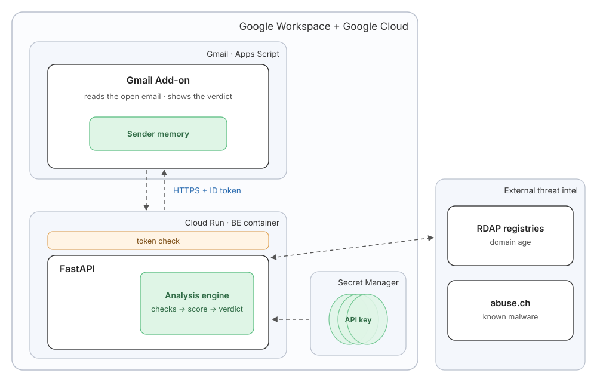

# Gmail Threat Scorer

A Gmail add-on that checks the email you have open for signs of phishing and other malicious content.

It runs 12 checks covering who really sent the email, where its links really lead, what its attachments really are, and whether it pressures you or asks for passwords or payment details. It adds up the evidence into a risk score from 0 to 100. The result appears in a panel beside the email: a verdict, the reasons behind it and advice on what to do.

## Highlights

- **Shows its reasons, not just a number:** the result panel lists every reason that raised the score, with its points. For example, "+35 · Link text doesn't match its destination" means the link shows one website but actually opens another. You can see *why* an email was flagged, not only *that* it was.
- **12 checks:** sender spoofing, lookalike domains, deceptive links, pressure language, requests for secrets, risky attachments, hidden content, domain age, known malware, and sender history.
- **Private:** read-only access to the open email; attachments never leave Google; no email content is stored or logged.

## Overview



1. You open an email, and the add-on reads **that message only**.
2. It sends the headers, the bodies and attachment fingerprints to the backend, with a Google identity token.
3. Cloud Run verifies the token. The backend runs the checks and adds up the points.
4. The result panel beside the email shows the verdict, the score, and the reasons.

## Security

- Only the add-on can call the backend: Cloud Run checks a Google-signed token, and no secret is stored anywhere.
- All email content is untrusted: strict input validation, size limits, and URL/HTML parsing that matches what browsers see.
- Links are never opened; outside lookups send only domain names and file hashes.
- The one API key lives in Google Secret Manager, never in the code.

## Usage

Open any email in Gmail and click the shield icon in the right-hand side panel. The add-on shows its result there. A typical result for a phishing email:

```
Verdict        ⛔ Malicious
               ██████████  100 / 100
Why            +50 · Look-alike of a well-known domain
               +35 · Link text doesn't match its destination
               +30 · Asks for private information
               +30 · Asks for secrets behind a disguise
               +10 · Pressure to act fast
What to do     Don't click links, open attachments or reply. Report it: Gmail's ⋮ menu → "Report phishing".
               Was this verdict right?  👍 Right   👎 Wrong
```

## Installation

Requirements: Python 3.11, Node.js, the Google Cloud CLI, and a Google Cloud project with billing enabled.

```bash
# Backend: test and deploy (from the repo root)
cd backend && python -m venv .venv && .venv/Scripts/python -m pip install -r requirements-dev.txt
.venv/Scripts/python -m pytest -q
powershell -ExecutionPolicy Bypass -File deploy.ps1

# Add-on: push to Apps Script (back at the repo root)
cd ..
npm i -g @google/clasp && clasp login
clasp create-script --type standalone --rootDir addon && clasp push
```

Then:
1. Put your Cloud Run URL in `addon/Config.js` and `addon/appsscript.json`.
2. Allow the add-on's client ID: `gcloud run services update <service> --add-custom-audiences=<client-id>`.
3. In the Apps Script editor: **Deploy → Test deployments → Install**, and open Gmail.

## Authors

**Shahaf Cohen** ([@Shahaf19](https://github.com/Shahaf19)), built with [Claude Code](https://claude.com/claude-code) as an AI pair programmer.
